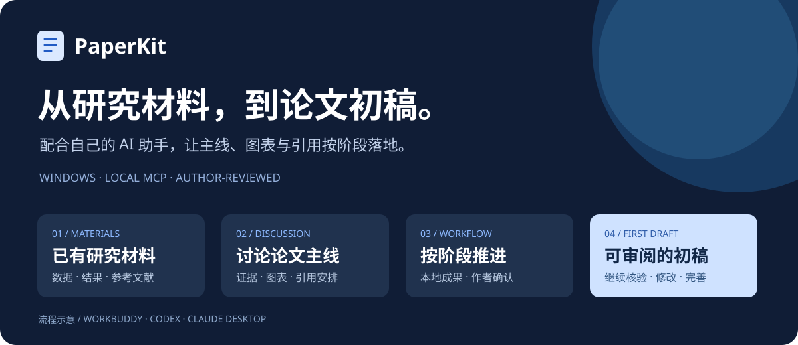

<strong>把已有的数据、结果和文献，逐步组织成可以审阅、修改的论文初稿。</strong>

Windows 本地工作台 · 连接自己的 AI 助手 · 作者逐阶段确认

<a href="https://github.com/WangJ226/PaperKit/releases/latest"><strong>下载 PaperKit</strong></a> · <a href="#13个阶段如何推进一篇论文">了解13个阶段</a> · <a href="GETTING_STARTED.md">首次使用</a> · <a href="FAQ.md">常见问题</a> · <a href="https://github.com/WangJ226/PaperKit/issues">反馈问题</a>

## 已有研究材料，怎样推进成一篇论文？

数据和结果已经有了，论文主线却还没理顺；参考文献读过不少，写作时仍然难以把图表、引用和结论连起来。PaperKit 面向这段从“研究材料”到“论文初稿”的过程。

**配合你自己的 WorkBuddy、Codex 或 Claude Desktop，从真实材料出发，与你讨论论文主线、安排图表与引用，按阶段推进中文初稿、英文稿和后续修改。**

你负责研究判断和关键确认；PaperKit 管理本地流程、证据与成果；AI 助手负责对话和具体任务执行。每个阶段都有目标、产物、检查与作者确认，方便你看清进度，也方便继续上一次工作。

| 你可能遇到的问题 | PaperKit 如何协助 |
|---|---|
| 材料很多，不知道从哪里开始 | 清点数据、脚本、结果和文献，分清事实、假设与待补证据 |
| 有结果，但不知道论文讲什么 | 比较主线方案，讨论研究问题、贡献与适用边界 |
| 图画了很多，仍然讲不清楚 | 先安排每张图要回答的问题，再依据确认的数据制作 |
| 想写初稿，却反复卡在结构上 | 先明确章节与段落任务，再逐节形成中文稿和英文稿 |
| 导师意见很多，容易漏改 | 把意见、修改位置、回复和检查结果连成可追踪记录 |
| AI 已经做完，软件里看不到进展 | 工作台每5秒自动刷新，同时保留手动刷新 |

## 13个阶段，如何推进一篇论文？

下列内容介绍完整工作流。实际推进取决于你的研究材料、AI工具能力、可用环境和作者确认。你可以先从 Stage 00–03 了解流程，再通过邀请体验完整阶段。

### Stage 00 · 约定研究目标与工作边界
**先回答：这次要做什么，哪些材料可以作为依据？**

与 AI 明确研究目的、目标读者、权威来源、读写权限、文献范围、证据要求和停止条件；同时检查基础运行环境。将讨论结果写成项目协议，让后续工作有共同依据。

**阶段成果：** 项目协议、来源边界清单和环境检查记录。

**你的确认：** 研究范围、材料使用方式与关键约束。

### Stage 01 · 理解项目，分清事实与缺口
**先回答：我们真正知道什么，还缺什么？**

梳理已有数据、程序、图表、计算结果和稿件，区分已验证事实、模型假设、方法选择、解释与待验证想法。遇到脚本版本和结果来源冲突时，先展示冲突及其对论文的影响。

**阶段成果：** 项目理解清单、主张与证据登记、材料冲突及缺口列表。

**你的确认：** 哪些材料具有权威性，论文结论可以说到什么程度。

### Stage 02 · 深读核心文献，建立研究背景
**先回答：相关研究怎样提出问题、组织证据，我们可以借鉴什么？**

从研究问题出发整理检索与下载清单。你通过可用渠道提供全文后，核对论文身份与版本，确认核心文献，再结合原文页码深读研究缺口、段落逻辑、结果解释和图表论证。比较不同论文，提炼适合本项目的术语与写作组织方式。

**阶段成果：** 核心文献清单、原文定位记录、深读笔记与对比综合。

**你的确认：** 核心文献范围，以及哪些经验适合当前研究。

### Stage 03 · 比较论文主线，明确贡献
**先回答：这些材料最适合讲一个怎样的研究故事？**

提出多个可行的主线方案，逐一比较研究问题、贡献链条、证据匹配度、与已有工作的差异及潜在审稿疑问。把“做了什么”进一步组织成“解决了什么问题、有什么证据”。

**阶段成果：** 主线候选方案、贡献与差异分析、推荐方向。

**你的确认：** 最终采用哪条主线，标题与主张的范围如何界定。

### Stage 04 · 把主张、证据和图表对应起来
**先回答：每个重要观点，靠什么让读者信服？**

为核心主张安排对应的数据、比较对象、指标和图表，明确每张图表承担的论证任务。对证据不足的部分列出补充需求；涉及参数比较、模型验证时，检查比较条件、单位和适用范围。

**阶段成果：** 主张—证据对应表、章节任务和有顺序的图表计划。

**你的确认：** 证据是否足够，图表安排是否支撑论文主线。

### Stage 05 · 冻结可信结果，统一数字来源
**先回答：哪些结果可以正式进入论文？**

核对权威数据、脚本配置、处理过程与输出版本，登记摘要和结论可使用的关键数字。保存来源与文件指纹，明确采用、替代和排除的结果，便于后续核查和复现。

**阶段成果：** 冻结结果清单、关键数字记录、来源及版本追踪。

**你的确认：** 本轮写作采用的结果版本与结论边界。

### Stage 06 · 先搭论证结构，再展开写作
**先回答：每一节、每一段分别要说明什么？**

把已确认的主线和结果拆成章节任务与段落提纲：这一段表达什么、引用哪些证据、与下一段怎样衔接、需要保留什么限定。结合核心文献的组织方式，形成适合当前项目的中文写作简报。

**阶段成果：** 章节框架、段落任务与证据对应、中文写作简报。

**你的确认：** 论证顺序是否清楚，各部分是否承担必要的任务。

### Stage 07 · 制作服务于论证的图表
**先回答：读者能否从图表中看懂关键发现？**

根据冻结数据和图表计划推进数据图、表格及适用的示意图，检查单位、标签、图例、字体、排列与科学含义。结合任务和可用工具保留可编辑源文件或生成脚本，并查看实际输出效果。额外绘图软件按所选方案准备。

**阶段成果：** 图表文件、可追踪的数据来源、适用的可编辑材料和视觉检查记录。

在 AI 会话中一次看一张图，说明哪里要改，认可后再看下一张。整套图完成后，回工作台批准本阶段。

### Stage 08 · 形成中文论文初稿
**先回答：能否用完整、清楚的文字讲透这项研究？**

沿着已批准的写作简报逐节成稿，把研究背景、方法、结果和讨论连起来。写完章节后回看段落结构，对照冻结证据复核重要主张、数字、图表及引用，让中文稿成为后续表达的逻辑基础。

**阶段成果：** 可供作者审阅和修改的中文章节与论文初稿。

想先打磨结果段，可以对 AI 说“只审这一段，给我看改后的正文和数据依据”。全文齐备时再说“现在审整稿”，由独立读者留下逐段观察和论证七问，再讨论修改。作者在工作台批准认可的整稿。

### Stage 09 · 推进英文稿，保持科学含义一致
**先回答：怎样用英文准确表达已确认的研究逻辑？**

按项目开始时选择的语言推进英文稿。已有中文稿时对照核查两种语言的主张；仅需英文稿时，直接根据写作简报和冻结证据核对术语、比较条件、数值和结论。

**阶段成果：** 英文论文稿、术语与关键主张的中英文核对记录。

**你的确认：** 英文表达是否准确传达原意，是否符合目标读者的阅读习惯。

### Stage 10 · 审阅整稿，导出可修改文件
**先回答：整套稿件是否一致，交到作者手中是否便于审阅？**

依次核对主张来源、章节一致性、图表与图注、参考文献及目标要求。按任务导出 Word 等审阅文件，检查结构与格式；需要时进一步查看页面渲染，登记实际检查范围和剩余问题。

**阶段成果：** Word 审阅稿、按需导出的 PDF、检查报告和待处理事项。

**你的确认：** 打开实际稿件审阅，决定下一步修改或投稿安排。

### Stage 11 · 跟进导师意见与多轮返修
**先回答：每一条意见是否落实到了稿件里？**

整理导师、合作者或审稿人的原始意见，逐项关联作者决定、具体修改、稿件位置、检查结果与回复。保留各轮历史，按实际任务准备批注稿或期刊返修材料，帮助你跟进多轮修改。

**阶段成果：** 意见与修改台账、修订稿、对应回复和轮次检查记录。

**你的确认：** 每条意见的处理是否充分，本轮继续修改还是结束。

### Stage 12 · 项目复盘，沉淀可复用经验
**先回答：这次完成后，下次怎样做得更好？**

项目结束后整理有效流程、反复出现的问题、写作偏好和返修经验，区分项目特有内容与可能长期复用的做法。结合来源、适用范围和冲突检查形成建议，再由作者决定如何采用。

**阶段成果：** 项目复盘、可复用经验候选和改进建议。

**你的确认：** 哪些经验保留在本项目，哪些值得进一步验证和复用。

> 这套流程的目标是帮助作者形成有证据依据、可以继续修改的稿件。材料完整度、AI能力和作者参与共同影响结果；研究事实、引用与最终内容由作者审阅确认。

## 用一个小任务开始

**01 下载并安装 → 02 连接自己的 AI 助手 → 03 选择项目副本 → 04 开始第一个阶段**

1. 在 [最新版本](https://github.com/WangJ226/PaperKit/releases/latest) 下载 **PaperKit-Setup.exe**。
2. 打开软件，填写联系邮箱开始体验；收到邀请码时，在软件内兑换入口按提示操作。
3. 在阶段页面选择 WorkBuddy、Codex 或 Claude Desktop，完成配置后重启 AI 客户端。
4. 复制阶段提示词给 AI，请它实际调用 `project_status`，再从你的研究材料开始。

基础体验覆盖 Stage 00–03，可反复体验；一台设备一个项目，每项目5篇核心文献。90天完整体验通过邀请开放：新码90天内领取，首次成功兑换后使用90天，绑定一台电脑。欢迎先用真实的小任务了解流程，再联系邀请者反馈适配情况。

详细步骤见 [首次使用指南](GETTING_STARTED.md)。

## 本地材料，清楚的使用边界

- 论文项目、原始数据和阶段材料保存在你的电脑；PaperKit授权服务处理账号、设备与权益信息。
- 使用自己的AI账户与可用模型服务。交给AI助手的内容按相应平台的数据政策处理，敏感材料请先确认分享范围。
- 支持 Windows 10/11 64位，运行环境随软件提供。
- Word相关功能需要兼容的 Microsoft Word；图表、格式和稿件内容由作者审阅。
- 当前安装包尚未完成 Authenticode 代码签名。请核对下载来源及同版 SHA-256，保留系统安全防护。

## Windows 版 0.3.56

新版支持在中文稿和英文稿阶段分别讨论段落、审阅整稿。首次整稿阅读的两份记录归档后，修订稿可接续原审阅。安装版内置 Kit 0.33.0-rc.19。本轮通过 806 项产品回归，并在 Windows 本机验证了覆盖安装、备份启动与卸载保护。

PaperKit 正处于早期持续开发阶段。不同电脑、三个AI客户端以及复杂论文的完整使用反馈正在收集；完整流程介绍与具体项目验收结果分别记录。欢迎带着真实材料参与体验，帮助我们验证适用范围与使用体验。

影响结论的数值请按来源复算，复杂公式请在 Word 中检查。版本变化见 [更新记录](CHANGELOG.md)，安装包和 SHA-256 校验文件见 [Releases](https://github.com/WangJ226/PaperKit/releases/latest)。

## 一起把 PaperKit 做得更好

遇到问题可在 [Issues](https://github.com/WangJ226/PaperKit/issues) 描述步骤，也可以使用软件中的“反馈问题与经验”：复制提示词交给AI，让它总结反馈文件，检查脱敏后提交。

**公开反馈请保留软件版本、操作步骤和错误提示，隐藏论文正文、授权码、邮箱、Token与个人路径。** 设备恢复及邀请码相关问题，请通过软件内提供方联系方式私下联系。

如果这个流程对你有帮助，欢迎 Star，或把页面分享给正在推进论文的老师、同学和研究伙伴。

---

**English overview** — PaperKit is a Windows research workflow workbench connected to your own AI assistant via MCP. Its 13 author-reviewed stages cover project understanding, literature reading, storyline development, evidence and figure planning, Chinese and English drafting, export, revision and retrospective. This repository hosts product documentation and downloadable releases. The application source is privately maintained.
